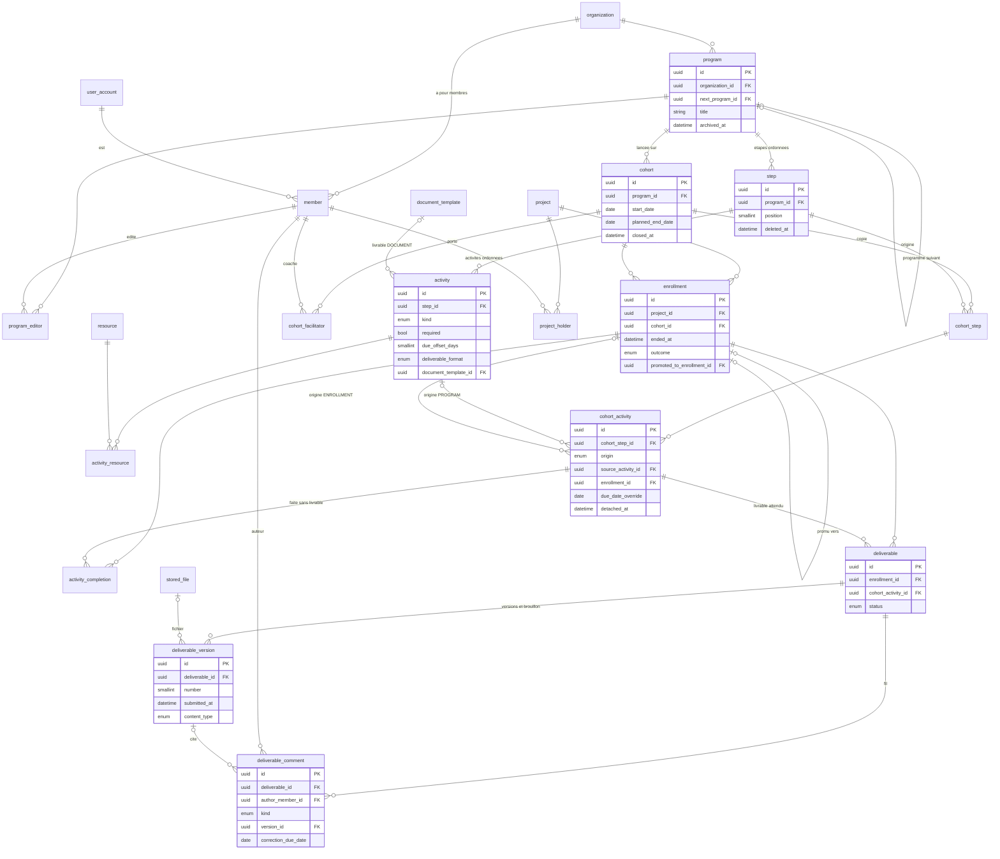
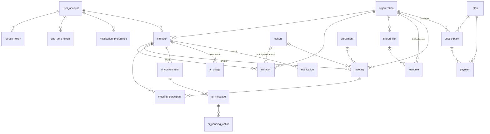

# JAPPO : modèle de données v2 (étape 3)

Statut : validé (y compris N1), complété le 20/11/2026 : règles de suppression (§ 12),
performance mesurée (§ 13), identifiants UUID (§ 14), isolation hors Hibernate (§ 15).
Source : `docs/produit.md` (validé). Schéma SQL complet : [`docs/schema-v1.sql`](schema-v1.sql),
chargé et testé sur MySQL 8.4 (voir § 9). Il deviendra la nouvelle migration Flyway V1 à
l'étape 6 ; d'ici là, l'application actuelle continue de tourner sur l'ancien schéma.

---

## 1. Décisions de conception

| # | Décision | Pourquoi |
|---|---|---|
| N1 | **Noms en anglais, `snake_case`, tables au singulier**, sans accents (`program`, `cohort_activity`, `deliverable_version`). Valeurs d'enum en `UPPER_SNAKE` anglais. L'interface reste en français. | Les colonnes demandées (`created_at`, `updated_at`, `created_by`) sont déjà en anglais : tout mettre en anglais supprime le mélange relevé par l'audit (M12). Pas de pluriels irréguliers (« parcours »), pas d'accents dans le code, termes neutres (`FACILITATOR`, `PARTICIPANT`) pour s'ouvrir à d'autres usages. |
| N2 | **Un seul type d'identifiant : UUID v7 en `BINARY(16)`**, généré par l'application. | Corrige M10 (`varchar(36)` mêlé à `binary(16)`). Le v7 est ordonné dans le temps : les index restent compacts, contrairement au v4 aléatoire. Généré côté application, l'identifiant est connu avant l'insertion. |
| N3 | **`organization_id` sur chaque table d'une structure**, avec des **clés étrangères composites** `(x_id, organization_id)` vers le parent. | La base elle-même interdit de rattacher un objet de la structure A à un objet de la structure B (testé, § 9). C'est aussi la colonne sur laquelle s'appuie le filtre automatique d'isolation (§ 6). |
| N4 | **`created_at`, `updated_at`, `created_by` sur toutes les tables**, y compris les tables de liaison. `created_by` pointe vers `user_account`. | Règle uniforme, portée par une classe de base unique côté Java. `created_by` vise le compte et non le membre : il reste valable pour le super-admin, les traitements automatiques et après le retrait d'un membre. Toutes les références **métier** à une personne passent, elles, par `member`. |
| N5 | **Aucune suppression en cascade** (`ON DELETE` restrictif partout). | Rien ne disparaît silencieusement. Les suppressions sont explicites dans le service, ou remplacées par un archivage ou une suppression annulable. |
| N6 | **Rien de ce qui se calcule n'est stocké** : statut d'une cohorte, d'un projet, d'une séance, d'une invitation ; progression ; étape en cours ; retards ; dernière version d'un livrable ; échéance effective. | Règle 3 du produit. Une seule source de vérité, pas de désynchronisation possible. Formules au § 5. |
| N7 | **Trois façons explicites de « retirer », chacune avec un sens précis** : `deleted_at` (suppression annulable, et trace pour les cohortes), `archived_at` (sorti des listes, consultable), `removed_at` / `revoked_at` / `cancelled_at` / `closed_at` (fin d'un état métier). | Corrige les trois conventions mêlées de l'audit (`archive`, `archivee`, statut `ARCHIVEE`). |
| N8 | **Unicité partielle par colonnes générées** : par exemple, une seule participation en cours par projet, un seul brouillon par livrable, une seule invitation en attente par email, un seul plan par défaut. | MySQL n'a pas d'index partiel ; une colonne générée virtuelle qui vaut `NULL` hors du cas visé, avec un index unique dessus, donne la même garantie, appliquée par la base. |
| N9 | **Enums natifs MySQL** pour les listes fermées. `VARCHAR` seulement pour les listes ouvertes, comme `notification_type` ou `ai_pending_action.action_type`. | Valeurs contrôlées par la base ; ajouter une valeur passe par une migration, ce qui est voulu. |
| N10 | **JSON seulement pour les contenus réellement structurés en document** : contenu d'un document modèle (`document_data`), définition d'un modèle, données externes (retour de paiement, citations de l'IA, contenu d'une notification). Jamais pour des relations. | Respect de la 1NF pour les données relationnelles ; le contexte d'une conversation IA, autrefois en JSON, devient trois clés étrangères. |
| N11 | **Dates et heures** : les `DATETIME(6)` sont en **UTC** ; les `DATE` (début de cohorte, échéances) sont des dates **locales à la structure** (`organization.timezone`). | Une échéance est « le 15 mars » pour la structure, quel que soit le fuseau du serveur ; les instants sont comparables partout. |

---

## 2. Diagrammes

### 2.1 Programme, cohorte, projet, livrables

### 2.2 Accès, séances, assistant IA, abonnement

Les colonnes communes (`id`, `organization_id`, `created_at`, `updated_at`, `created_by`) ne sont
pas répétées dans les diagrammes. Le détail de chaque colonne et contrainte est dans
`schema-v1.sql`.

---

## 3. Les tables et leur justification

37 tables : 6 globales (comptes, modèles de documents, plans) et 31 rattachées à une structure.

### 3.1 Comptes et accès (globales)

| Table | Rôle | Choix |
|---|---|---|
| `user_account` | Le compte de connexion d'une personne. | Une personne = un compte, quel que soit le nombre de structures. `token_version` : l'incrémenter invalide tous les jetons d'accès (changement de mot de passe, déconnexion partout). `password_hash` facultatif si connexion Google (`google_subject`), au moins l'un des deux (contrainte). Email stocké en minuscules (contrainte binaire, la collation ignorant la casse). |
| `refresh_token` | Jeton de renouvellement, envoyé en cookie httpOnly. | Stocké **haché**. `family_id` + `replaced_by_id` : rotation à chaque usage ; si un jeton déjà remplacé est réutilisé, toute la famille est révoquée (vol détecté). |
| `one_time_token` | Vérification d'email, réinitialisation du mot de passe. | Remplace deux tables de l'ancien schéma par un seul mécanisme (`purpose`). Haché, à usage unique (`consumed_at`). |
| `notification_preference` | Préférences de notification d'une personne. | Par compte, valables dans toutes ses structures. |

### 3.2 Structure et membres

| Table | Rôle | Choix |
|---|---|---|
| `organization` | La structure, frontière d'isolation des données. | Porte ses réglages d'accompagnement (`stalled_threshold_days` 3–180, défaut 21 ; `review_delay_days` 1–30, défaut 5 ; `timezone`), qui dépendent d'elle seule (3NF). Plus de `proprietaire_id` : les admins sont des membres. Statut calculé depuis `suspended_at`. |
| `member` | Une personne dans une structure, avec **un** rôle. | **La seule référence à une personne** dans tous les modules (corrige M8). Un compte n'a qu'un membre par structure (unique). `removed_at` : le membre retiré reste référencé par ce qu'il a produit (« ancien membre »). Plus de `cohorte_id` ni de jeton d'invitation (corrige M9). |
| `invitation` | **Le seul mécanisme d'entrée** dans une structure. | Nominative (email, rôle) ; pour un entrepreneur, la cohorte et le nom de projet proposé, interdits pour les autres rôles (contrainte). Jeton haché. Une seule invitation en attente par email et par structure (N8). « Expirée » se calcule (`expires_at`). « Renvoyer » renouvelle le jeton et la date sur la même ligne. |

### 3.3 Programme (le modèle)

| Table | Rôle | Choix |
|---|---|---|
| `program` | Le programme. | `next_program_id` dans la **même** structure (clé composite), différent de lui-même (contrainte) ; l'absence de boucle plus longue (A → B → A) est vérifiée par le service. `archived_at` (programme avec cohortes) et `deleted_at` (programme sans cohorte, suppression annulable) : voir § 12. `version` : verrou optimiste pour l'édition simultanée. |
| `program_editor` | Les coachs autorisés à éditer le contenu (décision D6). | Liaison programme–membre. |
| `step` | Étape ordonnée. | `position` unique parmi les étapes **non supprimées** d'un programme (N8). `deleted_at` permet « Annuler » et garde la trace pour les cohortes qui en ont une copie. |
| `activity` | Activité ordonnée d'une étape. | **Le livrable attendu est porté par l'activité** (`deliverable_format`, `document_template_id`) : il y en a au plus un, une table séparée en relation 1–0..1 n'apporterait rien. Les contraintes imposent un modèle si et seulement si le format est `DOCUMENT`. `due_offset_days` : échéance relative au début de la cohorte. |
| `activity_resource` | Ressources jointes à une activité. | Liaison simple, en remplacement de la « portée » polymorphe à quatre clés facultatives (corrige M7). |
| `document_template` | BMC, business plan, pitch deck. | Global, livré par migration. `definition` (JSON) décrit les sections et champs ; `definition_version` permet de faire évoluer un modèle sans casser les documents déjà rendus. |
| `resource` | Bibliothèque de la structure. | Fichier **ou** lien, exclusif (contrainte). |

**Correspondance avec l'ancien schéma** : `programmes`, `parcours`, `parcours_phases`, `phases`,
`etapes`, `missions_modeles`, `missions_etape`, `livrables_attendus` deviennent `program`, `step`,
`activity` (corrige M1, M3, M4).

### 3.4 Cohorte (la copie)

| Table | Rôle | Choix |
|---|---|---|
| `cohort` | La cohorte. | Ne référence **que** son programme (corrige M2 : plus de `parcours_id` ni de `phase_id`). Statut calculé depuis `start_date` et `closed_at`. `closed_at` et `closed_by_member_id` vont ensemble (contrainte). |
| `cohort_facilitator` | Coachs de la cohorte. | Pointe vers `member` (avant : vers `users`). |
| `cohort_step` | Copie d'une étape pour la cohorte. | `source_step_id` toujours renseigné (les cohortes n'ajoutent pas d'étapes, décision D2) ; une seule copie par étape d'origine. `detached_at` : étape retirée du programme mais conservée car des projets y ont travaillé. |
| `cohort_activity` | Activité du contenu de la cohorte. | Une seule table pour les trois origines (`origin`) : `PROGRAM` (copie, avec `source_activity_id`), `COHORT` (ajoutée pour toute la cohorte), `ENROLLMENT` (ponctuelle, avec `enrollment_id`). Les contraintes imposent la cohérence origine / référence. La colonne `cohort_id` et des clés composites garantissent que l'étape et la participation appartiennent bien à la **même cohorte** (testé). `due_date_override` : seule l'exception est stockée, l'échéance normale se calcule. |
| `cohort_activity_resource` | Ressources jointes, copiées au lancement. | La copie est complète : modifier les ressources du programme ne change pas une cohorte en cours. |

**Pourquoi des colonnes copiées et non une référence au programme** (titre, description, type,
échéance relative, format du livrable) : c'est la règle produit § 6.3. La cohorte doit rester
stable quand le programme change. Ce n'est pas une redondance au sens de la 3NF : ces colonnes
décrivent l'activité **de la cohorte**, qui peut légitimement différer de celle du programme.
Le lien `source_activity_id` sert seulement à calculer les différences et à appliquer les
modifications.

### 3.5 Projet et participation

| Table | Rôle | Choix |
|---|---|---|
| `project` | Le projet. | Ne stocke ni cohorte courante ni statut (corrige M5) : ils se déduisent de ses participations. |
| `project_holder` | Porteurs du projet. | Plusieurs porteurs possibles dès maintenant (corrige M14). |
| `enrollment` | Participation d'un projet à une cohorte. | **Remplace quatre mécanismes** (`progressions`, `historique_progression`, `participations_cohorte`, `transitions_phase`). En cours tant que `ended_at` est nul ; **une seule en cours par projet** (N8). `outcome`, `ended_at` et `ended_by_member_id` vont ensemble (contrainte). La promotion relie la participation terminée à la nouvelle (`promoted_to_enrollment_id`, issue `COMPLETED` obligatoire). L'historique complet du projet est la liste de ses participations. |
| `activity_completion` | Activité sans livrable marquée faite. | Seule donnée de progression stockée, parce que c'est un fait saisi par quelqu'un. La progression elle-même se calcule. |

### 3.6 Livrables

| Table | Rôle | Choix |
|---|---|---|
| `deliverable` | Le livrable d'une participation pour une activité. | **Ne recopie aucune colonne de version** (corrige M6) : il ne porte que son **statut courant**. Un seul livrable par participation et par activité. Clés composites : l'activité et la participation appartiennent à la même cohorte. |
| `deliverable_version` | Une version rendue, ou le brouillon. | `number` nul = brouillon ; **un seul brouillon** par livrable (N8) ; brouillon possible seulement pour un texte ou un document. Une version rendue a un numéro, une date et un auteur (contrainte), et le contenu exigé par son type (contraintes). La dernière version est celle qui a le plus grand numéro : rien à stocker en plus. |
| `deliverable_comment` | Le fil de commentaires. | Les actions de relecture y laissent leur trace (`kind` : `CHANGES_REQUESTED`, `APPROVED`, `REOPENED`). Une demande de correction exige un texte ; l'échéance de correction n'existe que sur une demande de correction (contraintes). Un commentaire peut citer une version **du même livrable** (clé composite). `deleted_at` : « message supprimé » sans casser le fil. |

**Le statut du livrable est la seule valeur « d'état » stockée** du module. C'est un choix
assumé : le statut se déduirait en théorie de la dernière version et du dernier commentaire de
relecture, mais il sert dans presque toutes les requêtes (alertes, listes, filtres). Il n'est
jamais recopié ailleurs, et il est modifié uniquement par le service des livrables, dans la même
transaction que la version ou le commentaire qui le justifie.

### 3.7 Séances, assistant IA, fichiers, notifications

| Table | Rôle | Choix |
|---|---|---|
| `meeting` | Séance en ligne ou en présentiel. | Statut calculé (horaires et `cancelled_at`). En ligne ⇔ salle LiveKit ; en présentiel ⇒ lieu (contraintes). Rattachement facultatif à une cohorte, une participation ou une activité de type séance. |
| `meeting_participant` | Participants. | Pointe vers `member`. |
| `ai_conversation` | Conversation avec l'assistant. | Identifiant en `BINARY(16)` comme partout (corrige M10). Contexte en clés étrangères (programme, cohorte, projet) au lieu d'un JSON. |
| `ai_message` | Messages. | `sources` en JSON : c'est la donnée renvoyée par le service IA. |
| `ai_pending_action` | Action proposée par l'IA, à confirmer. | « Expirée » se calcule (`expires_at`). Résolution cohérente avec le statut (contrainte). |
| `ai_usage` | Journal de consommation pour les quotas. | Séparé des messages, pour qu'archiver une conversation ne remette pas le compteur à zéro. |
| `stored_file` | Tout fichier téléversé. | `content_type` est le type **détecté sur le contenu** ; `sha256` pour l'intégrité. Les fichiers sont rangés par structure. |
| `notification` | Notification dans l'application. | Adressée à un membre ; `read_at`. |

### 3.8 Abonnement

| Table | Rôle | Choix |
|---|---|---|
| `plan` | Plans (Freemium, Premium). | Global. Un seul plan par défaut (N8). `max_open_cohorts` : limite des cohortes non closes. |
| `subscription` | **Une ligne par période** d'abonnement. | Remplace `abonnements` + `historique_abonnements`, qui se recopiaient. Une seule période courante par structure (N8) ; l'historique est l'ensemble des lignes. |
| `payment` | Paiement PayDunya. | Référence unique par fournisseur. Retour brut du fournisseur conservé (JSON) pour l'audit. |

### 3.9 Ce qui disparaît sans remplacement

`transitions_phase` (jamais écrite), `cohortes.parcours_id` et `phase_id`, `projets.cohorte_id`,
`projets.statut`, `projets.score_maturite`, `livrables.note` (pas de notation en phase 1),
`structures.type` (texte libre), `structures.proprietaire_id`, `membres_structures.cohorte_id`,
`invitation_links`, `ressources.portee`, `meetings.objectif` et `decisions` (remplacés par un
seul `summary`), `email_verification_codes` et `password_reset_tokens` (fusionnées dans
`one_time_token`).

---

## 4. Normalisation

- **1NF** : toutes les colonnes sont atomiques ; aucune liste dans une colonne (les anciennes
  listes en JSON du contexte IA deviennent des clés étrangères). Le JSON ne sert qu'à des
  documents (N10).
- **2NF** : les tables à clé composite (`program_editor`, `cohort_facilitator`,
  `project_holder`, `activity_resource`, `cohort_activity_resource`, `meeting_participant`,
  `activity_completion`, `notification_preference`) n'ont aucune colonne qui dépende d'une partie
  seulement de la clé.
- **3NF** : aucune colonne non clé ne dépend d'une autre colonne non clé. Les anciennes
  dépendances transitives sont supprimées (`cohortes.programme_id` déductible du parcours,
  `projets.cohorte_id` déductible des participations, colonnes recopiées des livrables).

**Redondances volontaires, toutes contrôlées par la base :**

| Colonne | Pourquoi | Comment elle reste juste |
|---|---|---|
| `organization_id` sur les tables filles | Isolation automatique (§ 6) et clés composites inter-structures. | Clés étrangères composites : une valeur différente de celle du parent est refusée. |
| `cohort_id` sur `cohort_activity`, `activity_completion`, `deliverable` | Garantir que l'activité et la participation appartiennent à la même cohorte. | Clés composites `(…, cohort_id)` vers les deux parents. |
| `deliverable.status` | Performance des listes et alertes (§ 3.6). | Écrit par un seul service, dans la même transaction que l'événement qui le change. |

---

## 5. Données calculées (jamais stockées)

| Valeur | Calcul |
|---|---|
| Statut d'une cohorte | `closed_at` renseigné : **Terminée** ; sinon date du jour (fuseau de la structure) < `start_date` : **À venir** ; sinon **En cours**. |
| Échéance effective d'une activité de cohorte | `due_date_override` si renseignée, sinon `cohort.start_date + due_offset_days`, sinon aucune. |
| Échéance de correction | `correction_due_date` du dernier commentaire `CHANGES_REQUESTED`, si le livrable est « à corriger ». |
| Activité terminée pour une participation | Avec livrable : `deliverable.status = APPROVED`. Sans livrable : une ligne `activity_completion` existe. |
| Date de fin d'une activité | Sans livrable : `completed_at`. Avec livrable : date du dernier commentaire `APPROVED`. |
| Progression d'une participation | Activités obligatoires terminées ÷ activités obligatoires du contenu (non supprimées ; activités ponctuelles d'autres participations exclues). |
| Étape en cours | Première `cohort_step` (par `position`) contenant une activité obligatoire non terminée. |
| Date d'entrée dans l'étape en cours | Date de fin la plus tardive des activités obligatoires de l'étape précédente ; pour la première étape, `enrollment.started_at`. |
| Projet bloqué | Participation en cours et (aujourd'hui − date d'entrée dans l'étape) > `organization.stalled_threshold_days`. |
| Livrable en retard | Statut `TO_SUBMIT` ou `CHANGES_REQUESTED` et échéance (de correction si elle existe, sinon effective) dépassée. |
| Retour en attente | Statut `SUBMITTED` ; attente = maintenant − `submitted_at` de la dernière version ; signalé si > `review_delay_days`. |
| Statut d'un projet | Celui de sa participation la plus récente (en cours, ou son `outcome`). |
| Chemin d'un projet | Ses participations par `started_at`, suivies des programmes suivants non encore commencés. |
| Statut d'une invitation | Acceptée, annulée, sinon expirée si `expires_at` est passé, sinon en attente. |
| Statut d'une séance | Annulée si `cancelled_at` ; sinon prévue, en cours ou terminée selon `starts_at` et `duration_minutes`. |
| Consommation IA du mois | Somme de `ai_usage` de la structure sur le mois civil. |

Ces calculs vivent dans un seul composant côté back-end (et ses requêtes SQL), testé une fois.
Les index du § 7 couvrent les requêtes correspondantes.

---

## 6. Isolation des structures

Trois niveaux, du plus automatique au plus explicite :

1. **Filtre automatique** : chaque entité d'une structure porte `organization_id` marqué
   `@TenantId` (Hibernate). La structure active, issue du jeton et de l'adhésion vérifiée, est
   fournie à Hibernate pour chaque requête : les lectures sont filtrées et les écritures
   renseignées automatiquement. Les services n'écrivent plus de vérification à la main.
2. **Base de données** : les clés étrangères composites empêchent tout lien entre deux structures,
   même en cas de bug du code.
3. **Tests** : un test par module tente de lire, modifier et relier des objets d'une autre
   structure, et doit échouer (étape 6).

Le filtre Hibernate ne couvre pas tout : les requêtes SQL natives, le WebSocket, les traitements
planifiés et les fichiers sont protégés autrement (§ 15, vérifié par une sonde).

Les tables globales (`user_account`, `refresh_token`, `one_time_token`,
`notification_preference`, `document_template`, `plan`) ne contiennent aucune donnée
d'accompagnement.

---

## 7. Index

Les clés primaires, les contraintes d'unicité et les clés étrangères (MySQL indexe chaque clé
étrangère) couvrent l'essentiel. Index ajoutés pour les recherches fréquentes :

| Index | Sert à |
|---|---|
| `enrollment (cohort_id, ended_at)` | Projets en cours d'une cohorte, répartition par étape. |
| `enrollment (project_id, started_at)` | Participation la plus récente d'un projet (écran Projets), chemin du projet. Ajouté après mesure (§ 13). |
| `deliverable (cohort_id, status)` | Alertes et compteurs par cohorte. |
| `deliverable_version (deliverable_id, submitted_at)` | Dernière version, attente de retour. |
| `deliverable_comment (deliverable_id, created_at)` | Fil de commentaires dans l'ordre. |
| `cohort_activity (enrollment_id)` | Activités ponctuelles d'un projet. |
| `project (organization_id, name)` | Recherche et tri dans l'écran Projets. |
| `meeting (organization_id, starts_at)` | Prochaines séances. |
| `meeting_participant (member_id)` | Séances d'une personne. |
| `notification (recipient_member_id, read_at, created_at)` | Notifications non lues. |
| `ai_usage (organization_id, created_at)` | Consommation du mois. |
| `refresh_token (family_id)`, `one_time_token (user_id, purpose)` | Révocation, jetons en cours. |

---

## 8. Modules : garder, corriger ou réécrire

| Module | Décision | Ce qui change |
|---|---|---|
| Authentification | **Corriger** | Garder BCrypt, JWT signé, connexion Google. Ajouter : jeton d'accès court + `refresh_token` (cookie httpOnly, rotation), `token_version` (révocation), `one_time_token` unique, limitation de débit, authentification du WebSocket. |
| Structure, membres, invitations | **Réécrire** | `organization`, `member` (seule référence à une personne), `invitation` (seul mécanisme). |
| Programmes, parcours, phases, étapes | **Réécrire** | `program` → `step` → `activity`. Parcours et phases disparaissent. |
| Missions | **Supprimé** | Remplacées par `cohort_activity` (activités de cohorte et ponctuelles) et `deliverable`. |
| Cohortes et participations | **Réécrire** | `cohort` avec sa copie (`cohort_step`, `cohort_activity`), `enrollment`. |
| Progression | **Supprimé** | Devient un calcul (§ 5). |
| Projets | **Réécrire** | `project`, `project_holder` ; statut et cohorte calculés. |
| Livrables | **Réécrire** | `deliverable`, `deliverable_version`, `deliverable_comment`. |
| Modèles de documents | **Réécrire** | `document_template` (BMC repris, business plan et pitch deck ajoutés). |
| Ressources | **Réécrire** | Bibliothèque simple, jointe aux activités. |
| Réunions LiveKit | **Corriger** | Garder le client LiveKit ; `meeting` pointe vers `member`, statut calculé. |
| Assistant IA | **Corriger** | Garder l'appel à `jappo-ai` et les quotas ; identifiants unifiés, contexte en clés étrangères, actions proposées adaptées au nouveau modèle. |
| Abonnements et paiement | **Corriger** | Garder le client PayDunya et la logique de quotas ; fusionner les deux tables d'abonnement en périodes. |
| Fichiers | **Corriger** | `stored_file`, type réel vérifié (Tika), liste blanche. |
| Notifications | **Nouveau** | `notification`, `notification_preference`. |
| Tableau de bord, rapports | **Réécrire** | Calculs du § 5 (alertes, répartition, progression moyenne). |
| Super-admin | **Corriger** | Adapté au nouveau modèle, sans accès au contenu d'accompagnement. |
| Assistance (n8n) | Inchangé | Toujours désactivée, hors schéma. |

---

## 9. Vérification

`schema-v1.sql` se charge sans erreur sur MySQL 8.4.11 (37 tables, 137 clés étrangères,
45 contraintes `CHECK`). Un jeu de 36 cas a été rejoué sur une base vide : chaque règle
ci-dessous est **appliquée par la base**, les cas interdits sont refusés et les cas permis
acceptés.

| Domaine | Cas vérifiés |
|---|---|
| Isolation | Programme suivant, cohorte, coach de cohorte rattachés à une autre structure : refusés. |
| Programme | Programme suivant = lui-même ; deux étapes à la même position (refusé), mais position réutilisable après une suppression annulable ; cohérence format DOCUMENT / modèle. |
| Cohorte | Origine PROGRAM sans source, ponctuelle sans participation, participation ou étape d'une autre cohorte : refusés ; activité de cohorte : acceptée. |
| Participation | Deux participations en cours pour un projet ; fin sans issue ; promotion avec une issue autre que COMPLETED : refusés ; promotion complète : acceptée. |
| Livrables | Activité d'une autre cohorte ; doublon de livrable ; deuxième brouillon ; brouillon de fichier ; version sans auteur ; deux versions n° 1 ; correction sans texte ; échéance sur un simple commentaire ; citation d'une version d'un autre livrable : refusés. |
| Invitations | Deuxième invitation en attente ; coach rattaché à une cohorte ; email en majuscules : refusés. |
| Abonnement | Deux plans par défaut ; deux abonnements courants : refusés. |

Le générateur du schéma et ce jeu de tests sont dans `docs/modele/`. Ils seront remplacés à
l'étape 6 par la migration Flyway et des tests d'intégration Java.

---

## 10. Extensions prévues (hors phase 1)

Aucune n'est construite, et aucune colonne inutilisée n'est ajoutée maintenant. Chacune s'ajoute
plus tard par une migration, sans rien modifier de l'existant :

| Extension | Ajout prévu |
|---|---|
| Coach indépendant | Une `organization` d'une seule personne, à la fois `ADMIN` et coach : aucun changement de schéma ; plus tard une colonne `organization.kind`. |
| Catalogue public | `program.published_at` et une page publique ; inscription via `invitation` ou une candidature. |
| Bailleurs | Une table `funding_link (funder_organization_id, organization_id, starts_at, ends_at)` et des rapports en lecture seule sur les structures financées. |
| WhatsApp | Un canal de plus dans `notification_preference`. |
| Documents collaboratifs en temps réel | Le brouillon de `deliverable_version` devient un document partagé ; le modèle de version ne change pas. |
| Remplacement de `jappo-voice` | Aucun impact sur le schéma. |

---

## 11. Points à régler à l'étape 6

- **Correspondance Java** : vérifier, avec `ddl-auto=validate`, que les types `BOOLEAN`
  (`tinyint(1)`), `ENUM` et `JSON` sont acceptés par Hibernate, et le régler explicitement sinon.
- **Réorganisation** : l'unicité des positions impose de renuméroter en deux temps dans une
  transaction (décalage temporaire, puis positions finales).
- **UUID v7** : générateur Hibernate `@UuidGenerator(style = VERSION_7)` ou équivalent.
- **Données de démonstration** : le cas Fabrique 360 du produit, chargé en profil `dev` à partir
  de ce schéma.

---

## 12. Suppression et archivage, entité par entité

Rien ne se supprime en cascade (N5). Pour chaque entité, une seule règle :

- **Archiver** (`archived_at`) : masqué des listes, conservé et consultable, réversible.
- **Mettre fin** (`removed_at`, `revoked_at`, `cancelled_at`, `closed_at`, `ended_at`) : un état
  métier terminé, conservé pour l'historique.
- **Corbeille** (`deleted_at`) : masqué immédiatement, restaurable par « Annuler », puis **purgé
  définitivement** par une tâche quotidienne au bout de 30 jours, **seulement si rien ne le
  référence**. Sinon il reste en corbeille indéfiniment, car il sert d'origine à une copie.
- **Vraie suppression** : seulement quand l'élément **n'a aucun historique**, c'est-à-dire rien
  qui le référence et rien qui ait été produit à partir de lui.

| Entité | Archiver ou mettre fin | Vraie suppression possible si… | Sinon |
|---|---|---|---|
| `organization` | `suspended_at` (super-admin) | jamais en phase 1 | suspendre |
| `user_account` | `disabled_at` | jamais : le compte est référencé par `created_by` | anonymiser (nom et email remplacés) à la demande de la personne |
| `member` | `removed_at` (« ancien membre ») | aucune référence (aucun livrable, commentaire, participation, séance, invitation envoyée) | retirer |
| `invitation` | `revoked_at` | jamais : c'est la trace de l'entrée dans la structure | annuler |
| `program` | `archived_at` s'il a des cohortes | aucune cohorte : corbeille (`deleted_at`, « Annuler »), avec ses étapes et activités | archiver |
| `step`, `activity` (programme) | — | corbeille ; purgée si aucune copie de cohorte ne la référence | rester en corbeille (origine des copies) |
| `program_editor`, `cohort_facilitator`, `activity_resource`, `cohort_activity_resource`, `meeting_participant` | — | toujours : ce sont des liaisons sans historique propre | — |
| `project_holder` | — | toujours (ce que le porteur a produit reste rattaché à son membre) | — |
| `resource` | `archived_at` si elle est jointe à une activité | jamais jointe | archiver |
| `stored_file` | — | plus aucune référence (purge automatique des fichiers orphelins) | — |
| `cohort` | `closed_at` | aucune participation, aucune invitation acceptée, aucune séance (cohorte lancée par erreur) : supprimée avec son contenu copié | clore |
| `cohort_step`, `cohort_activity` d'origine PROGRAM | `detached_at` (retirée du programme) | aucun livrable ni activité marquée faite (lors de « appliquer les modifications ») | détacher |
| `cohort_activity` d'origine COHORT ou ENROLLMENT | — | aucun livrable ni activité marquée faite : corbeille (« Annuler »), puis purge | suppression refusée ; proposer « rendre facultative » |
| `project` | — | aucune participation | jamais supprimé |
| `enrollment` | `ended_at` + `outcome` | aucun livrable, activité faite, activité ponctuelle ni séance (inscription par erreur) | mettre fin |
| `activity_completion` | — | toujours (« marquer comme non faite ») | — |
| `deliverable` | — | aucune version rendue et aucun commentaire (brouillon abandonné) | jamais |
| `deliverable_version` | — | brouillon (`number` nul) | une version rendue n'est jamais supprimée |
| `deliverable_comment` | `deleted_at` par l'auteur dans les 15 minutes (« message supprimé ») | jamais | — |
| `meeting` | `cancelled_at` | jamais | annuler |
| `ai_conversation` | `archived_at` | à la demande du propriétaire, avec ses messages et actions (le journal `ai_usage` est conservé) | — |
| `ai_usage`, `subscription`, `payment` | — | jamais (quotas, comptabilité) | — |
| `plan` | `archived_at` | jamais utilisé | archiver |
| `notification` | `read_at` | purge automatique au bout de 90 jours | — |
| `refresh_token`, `one_time_token` | `revoked_at`, `consumed_at` | purge automatique après expiration | — |
| `notification_preference` | — | toujours (retour aux valeurs par défaut) | — |
| `document_template` | — | jamais (les documents rendus en dépendent) | — |

Ces règles sont appliquées par les services, et testées module par module (étape 6).

---

## 13. Performance des calculs (mesurée)

Les valeurs calculées (§ 5) ne sont pas stockées : il fallait vérifier qu'elles restent rapides.

**Jeu de charge** (`docs/modele/charge.py`) : 1 structure avec 10 programmes, 30 cohortes
(10 terminées, 20 en cours), 360 activités de cohorte, 500 projets, 600 participations (dont 100
promotions), **5 084 livrables**, 3 558 versions, 3 298 commentaires, 689 activités faites ; plus
une seconde structure « bruit » (120 projets) pour vérifier le filtrage. MySQL 8.4 local, médiane
de 7 exécutions après 2 de chauffe.

| Requête | Temps médian | Objectif < 300 ms |
|---|---|---|
| Tableau de bord d'un programme : cohortes (projets, progression moyenne, coachs) | 10 ms | ✓ |
| Tableau de bord : alertes (retards, bloqués, retours en attente) | 13 ms | ✓ |
| Tableau de bord : répartition des projets par étape | 10 ms | ✓ |
| **Tableau de bord complet** (3 requêtes) | **33 ms** | ✓ |
| Écran Projets, page de 50, tri par nom (total de pagination inclus) | 141 ms | ✓ |
| Écran Projets, tri par progression, page 5 | 143 ms | ✓ |
| Écran Projets, filtre « en retard », tri par retards | 134 ms | ✓ |
| Écran Projets, filtre « bloqués » | 146 ms | ✓ |

**Ajustements faits pendant la mesure**
- Le total de la pagination est calculé dans la même requête (`COUNT(*) OVER ()`) : une requête
  séparée coûtait autant que la page (environ 150 ms) et doublait le temps de l'écran.
- Index `enrollment (project_id, started_at)` ajouté : environ 10 % de gain sur l'écran Projets.

**Limite connue** : l'écran Projets calcule l'état de tous les projets de la structure avant de
trier. Le coût croît avec leur nombre (environ 0,3 ms par projet ici), soit environ 300 ms
vers 1 000 projets actifs dans une même structure. Si une structure approche ce volume, la
solution prévue est une **table de lecture** (`enrollment_progress` : progression, étape en
cours, date d'entrée, compteurs), mise à jour dans la même transaction que les événements qui la
changent (rendu, validation, activité faite). Ce serait un cache reconstructible, pas une source
de vérité. Ce n'est pas nécessaire en phase 1.

**Requêtes** : elles sont écrites dans `charge.py` (blocs `STATE`, `Q_COHORTS`, `Q_ALERTS`,
`Q_DISTRIBUTION`, `Q_PROJECTS`) et serviront de base au module de lecture du back-end
(§ 15.1). Toutes filtrent explicitement sur `organization_id` ; la structure bruit voit
exactement ses 120 projets.

---

## 14. Identifiants : un seul mapping UUID ↔ `BINARY(16)`

**Constat** (sonde Hibernate 7.4 sur MySQL 8.4) : un attribut Java `UUID` est déjà stocké en
`binary(16)` par défaut, et de même avec le réglage explicite. L'ancien bug venait d'un
identifiant déclaré en `String` (conversations en `varchar(36)`), pas du mapping.

**Règle**
1. Tout identifiant et toute référence sont de type `java.util.UUID`. Aucun identifiant en
   `String` ou `byte[]`.
2. Réglage global explicite, pour ne pas dépendre d'un défaut :
   `spring.jpa.properties.hibernate.type.preferred_uuid_jdbc_type=BINARY`.
3. Une seule classe de base porte l'identifiant (`@Id`, générateur UUID v7) et les colonnes
   d'audit ; aucune entité ne déclare son propre `@Id`.
4. Côté API, les identifiants circulent en texte (format UUID standard) ; la conversion est faite
   une seule fois, par Jackson et Spring.

**Tests (premiers tests écrits à l'étape 6)**
- **Test du métamodèle** : démarre Hibernate, parcourt toutes les entités, et échoue si un
  identifiant ou un attribut terminé par `Id` n'est pas de type `UUID`, ou si son type JDBC n'est
  pas `BINARY`.
- **Test d'architecture** : échoue si une classe annotée `@Entity` ne descend pas de la classe de
  base, ou si un `@Id` est déclaré ailleurs.
- **Validation du schéma** : `ddl-auto=validate` au démarrage compare chaque colonne au mapping ;
  un `String` face à un `binary(16)` empêche l'application de démarrer.

---

## 15. Isolation hors du filtre Hibernate

**Constat** (même sonde, deux structures A et B, session ouverte pour B) :

| Accès | Résultat |
|---|---|
| Requête HQL ou Criteria | filtrée : 0 ligne de A |
| Lecture par identifiant (`find`) d'un objet de A | `null` : protégé |
| Insertion par B d'un objet marqué « structure A » | refusée par Hibernate |
| `organization_id` à l'insertion | renseigné automatiquement |
| **Requête SQL native** | **non filtrée : voit les lignes de A** |

Le filtre est donc fiable pour tout ce qui passe par les entités. Les autres chemins sont protégés
ainsi :

### 15.1 Requêtes SQL natives

- Autorisées **uniquement** dans un module de lecture dédié (tableau de bord, écran Projets,
  alertes : les requêtes du § 13). Interdites partout ailleurs.
- Chaque méthode de ce module reçoit la structure en premier paramètre, fournie par le contexte
  de sécurité et jamais par la requête HTTP ; chaque requête filtre sur `organization_id` pour
  **chaque** table de structure qu'elle lit.
- Tests : un test d'architecture refuse toute requête native hors de ce module ; un test
  d'isolation rejoue chaque requête de lecture avec deux structures et vérifie qu'aucune ligne
  de l'autre structure n'apparaît (comme la vérification « bruit » du § 13).
- La base ajoute une seconde barrière : les clés composites empêchent qu'une jointure relie deux
  structures.

### 15.2 WebSocket

- Le WebSocket ne passe pas par Hibernate : il est protégé à la connexion et à l'abonnement.
- **Connexion** (`CONNECT`) : jeton d'accès obligatoire, vérifié comme pour l'API ; sinon refus.
- **Abonnement** : seulement aux destinations **personnelles** (`/user/queue/...`), résolues par
  Spring à partir de l'utilisateur authentifié. Aucun canal par structure ou par cohorte qu'on
  pourrait deviner (corrige la faille S1 de l'audit) : quand un événement concerne plusieurs
  personnes, le serveur l'envoie à chacune.
- Chaque message porte l'identifiant de la structure ; le front-end ignore ceux d'une autre
  structure que celle active.
- Tests : connexion sans jeton refusée ; abonnement à la destination d'un autre utilisateur
  refusé ; un événement de A n'atteint aucun membre de B.

### 15.3 Traitements planifiés

Expiration des abonnements, purges, rappels d'échéance : ils tournent hors de toute requête,
donc sans structure active. Chacun **parcourt les structures et ouvre une session par
structure**. Un seul composant, réservé aux tâches d'administration (purges), peut ouvrir une
session sans filtre ; il est couvert par un test d'architecture.

### 15.4 Fichiers

Un fichier n'est jamais servi par son chemin : le téléchargement passe par une route de l'API qui
lit `stored_file` (donc filtrée) puis renvoie le contenu, avec `Content-Disposition` et le type
détecté. Les noms de stockage sont aléatoires et rangés par structure.
